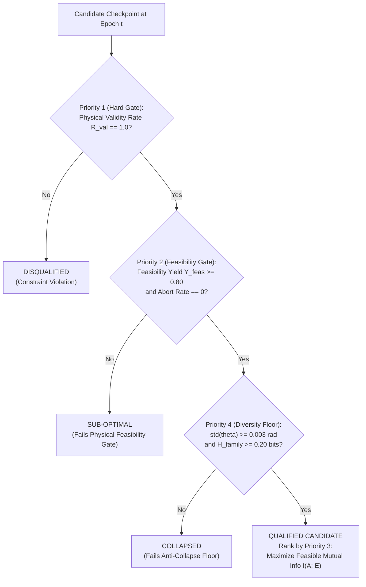

# MILESTONE 3 — STAGE C: FINAL TRAINING AUTHORIZATION REPORT

**Project:** Adaptive QGAN-Based Eavesdropping in BB84 QKD: Resource-Constrained Conditional Quantum Generative Approach under NISQ Noise  
**Stage:** Milestone 3 — Stage C (Final Training Authorization Gate)  
**Date & Timestamp:** 2026-11-10T19:10:00+05:30  
**Workspace Worktree:** `C:\Users\lenovo\.gemini\antigravity\worktrees\bb84-qgan-research\nisq_noise_modelling`  
**Main Repository:** `C:\Users\lenovo\bb84-qgan-research`  
**Hardware Profile:** NVIDIA GeForce RTX 3050 Laptop GPU (6,143.5 MB VRAM), CUDA 12.1, PyTorch 2.5.1+cu121, Python 3.11.9, Qiskit 2.6.0, Qiskit Aer 0.18.0  
**Status:** **SCIENTIFIC ISSUES RESOLVED — RUNNER HARDENED — 144/144 TESTS PASSED — AWAITING FORMAL AUTHORIZATION**

---

## 1. Scientific Objective and Constrained Optimization Formulation

### Physical Eavesdropping Problem in Resource-Constrained BB84
In a prepare-and-measure BB84 protocol under environmental noise $\mathcal{E}(\gamma)$, Alice and Bob estimate the Quantum Bit Error Rate (QBER) $Q_{\text{test}}$ on a sacrificed test fraction $\rho_{\text{test}}$ of sifted pulses. If the conservative Wilson score upper confidence bound $Q_{\text{UCB}}$ exceeds the protocol security threshold $Q_{\text{budget}}$, the session is immediately aborted and key generation fails:
$$\text{Abort Decision} = \mathbb{I}[Q_{\text{UCB}}(\pi; \mathcal{E}) > Q_{\text{budget}}]$$

Eve's operational goal is **not** to induce zero disturbance (which can be trivially achieved by the inactive Null policy $\pi_{\text{Null}}$, yielding zero mutual information $I(A; E) = 0$), but rather to maximize the mutual information extracted from Alice's raw bits while ensuring that the induced disturbance remains within the undetected threshold.

### Mathematical Formulation
The objective of the conditional generator $G_\phi(z, c)$ is formalized as a **Constrained Optimization Problem**:
$$\max_\phi \quad \mathbb{E}_{c \sim \mathcal{C}, \, z \sim p(z)} \Big[ I(A; E)\big(\pi, c\big) \Big]$$
$$\text{subject to:} \quad \begin{cases}
Q_{\text{UCB}}(\pi, c) \le Q_{\text{budget}} & \text{(Physical Feasibility under 95\% Wilson Bound)} \\
\text{Abort}(\pi, c) = 0 & \text{(Zero Session Aborts)} \\
\pi \in \Omega_{\text{valid}} & \text{(Hard Parameter Bounds: } \theta_E \in [0, \pi/4], \, \alpha, \beta \in [0, 1]\text{)} \\
\pi \ne \pi_{\text{Null}} & \text{(Non-Triviality / Active Information Extraction)} \\
\text{Var}(\pi \mid c) > 0 & \text{(Non-Collapsing Continuous Parameter Dispersion)}
\end{cases}$$
where $\pi = G_\phi(z, c)$ and $c = [Q_{\text{budget}}, \hat{\gamma}_{\text{noise}}]$.

---

## 2. Revised Checkpoint-Selection Procedure: Lexicographic Hierarchy & Pareto Preservation

The previous linear scalar combination ($S_{\text{val}} = 0.40 Y_{\text{feas}} + 0.25 R_{\text{val}} + 0.15 D_{\text{cont}} + 0.10 P_{\text{eq}} + 0.10 C_{\text{cond}}$) possessed two key defects:
1. It did not directly optimize Eve's mutual information $I(A; E)$.
2. It forced an arbitrary scalar ranking across conflicting physical dimensions.

### The Lexicographic Selection Hierarchy
Checkpoint selection on held-out validation conditions ($C17$–$C20$) is now governed by a strict **Lexicographic Priority Order**:



1. **Priority 1 (Hard Gate — Physical Validity):**
   - $R_{\text{val}} = \frac{1}{N_{\text{val}}} \sum_{i=1}^{N_{\text{val}}} \mathbb{I}[\pi_i \text{ satisfies all physical parameter bounds}]$.
   - Probe policies must satisfy $0 \le \theta_E \le \pi/4$.
   - PIR policies must satisfy $0 \le \alpha \le 1.0$ and $0 \le \beta \le 1.0$.
   - **Requirement:** $R_{\text{val}} = 1.0$ (100.0%). Any parameter violation immediately disqualifies the epoch.
2. **Priority 2 (Feasibility Gate — Statistical Safety):**
   - Feasibility yield $Y_{\text{feas}} = \frac{1}{N_{\text{val}}} \sum_{i=1}^{N_{\text{val}}} \mathbb{I}[Q_{\text{UCB}, i} \le Q_{\text{budget}, i} \text{ and not aborted}]$.
   - **Gate Requirement:** $Y_{\text{feas}} \ge 0.80$ (at least 80% of generated policies must be statistically feasible without triggering protocol aborts).
   - Feasible, indeterminate, and infeasible policies are counted separately; empirical abort count is reported as an independent metric.
3. **Priority 3 (Primary Physical Objective — Maximize Eve Information):**
   - Evaluated **strictly among feasible non-null policies**:
     $$\bar{I}_{\text{feas}} = \frac{1}{|\mathcal{S}_{\text{feas}}| \vphantom{1}} \sum_{i \in \mathcal{S}_{\text{feas}}} I(A; E)_i, \quad \mathcal{S}_{\text{feas}} = \{i : \text{Feasible}_i \text{ and } \pi_i \ne \text{Null}\}$$
   - Null policies are explicitly excluded from information reward ($I_{AE}(\text{Null}) = 0$).
   - Full distribution reporting: mean, median ($Q_{50}$), 75th percentile ($Q_{75}$), 90th percentile ($Q_{90}$), and maximum.
4. **Priority 4 (Anti-Collapse Floor):**
   - Continuous parameter standard deviation: $\sigma(\theta_E) \ge 0.003\text{ rad}$ ($0.17^\circ$), $\sigma(\alpha) \ge 0.010$.
   - Family Shannon entropy: $H_{\text{family}} \ge 0.20\text{ bits}$.
5. **Discriminator Equilibrium Proximity as Diagnostic:**
   - $P_{\text{eq}} = \max(0, 1 - |L_{D,\text{val}} - 2\ln 2| / (2\ln 2))$ is recorded strictly as an adversarial diagnostic, **not** as a primary ranking objective.

### Multi-Candidate Pareto Preservation
To prevent forcing an unsupported single scalar score when checkpoints exhibit distinct physical trade-offs, the trainer preserves the empirical **Pareto-Optimal Checkpoints**:
- `checkpoints/classical_cgan/cgan_m4a_lexicographic_best.pt`: Highest mean mutual information $\bar{I}_{\text{feas}}$ among all checkpoints passing the 80% feasibility gate.
- `checkpoints/classical_cgan/cgan_m4a_max_feasibility.pt`: Highest overall feasibility yield $Y_{\text{feas}}$ (with secondary preference for non-zero $I_{AE}$).
- `checkpoints/classical_cgan/cgan_m4a_balanced_pareto.pt`: Best compromise on the empirical Pareto frontier maximizing $Y_{\text{feas}} \times \bar{I}_{\text{feas}}$.
- `checkpoints/classical_cgan/cgan_m4a_latest.pt`: Final state at Epoch 200.

---

## 3. Controlled Counterfactual Evaluation for Conditional Consistency

### Flaw in Previous Approach
In earlier evaluations, validation conditions varied both $Q_{\text{budget}}$ and the noise estimate $\hat{\gamma}_{\text{noise}}$ simultaneously, confounding whether Eve's policy shift was driven by error tolerance or channel noise.

### Controlled Counterfactual Design
We construct a rigorous counterfactual experiment: **vary $Q_{\text{budget}}$ while holding $\hat{\gamma}_{\text{noise}}$ strictly constant**, evaluated across fixed paired latent vectors $Z_{\text{cf}} \sim \mathcal{N}(0, I_{16})$:

| Counterfactual Slice | Fixed Noise Parameter ($\hat{\gamma}_{\text{noise}}$) | Tight Budget ($Q_1$) | Loose Budget ($Q_2$) | Latent Noise Inputs |
| :--- | :---: | :---: | :---: | :---: |
| **Low-Noise Slice ($p=0.010$)** | $\hat{\gamma}_{\text{low}} = 0.0069$ (from C17) | $0.050$ | $0.110$ | Identical $Z_{\text{cf}} \in \mathbb{R}^{16 \times 16}$ |
| **Medium-Noise Slice ($p=0.030$)** | $\hat{\gamma}_{\text{med}} = 0.0205$ (from C19) | $0.050$ | $0.110$ | Identical $Z_{\text{cf}} \in \mathbb{R}^{16 \times 16}$ |

For each candidate $k \in \{1, \dots, 16\}$, we measure the exact paired differential response:
$$\Delta \theta_E(k) = \theta_E(Z_{\text{cf}, k}, [0.110, \hat{\gamma}]) - \theta_E(Z_{\text{cf}, k}, [0.050, \hat{\gamma}])$$
$$\Delta \alpha(k) = \alpha(Z_{\text{cf}, k}, [0.110, \hat{\gamma}]) - \alpha(Z_{\text{cf}, k}, [0.050, \hat{\gamma}])$$

### Physical Expectation vs. Mathematical Property
- **Physical Expectation:** Under a higher error threshold ($Q_{\text{budget}} = 0.110$ vs. $0.050$), Eve has more room to induce disturbance without triggering an abort ($\Delta Q \le Q_{\text{budget}} - Q_{\text{env}}$). Therefore, an optimal eavesdropper should couple more strongly ($\Delta \theta_E > 0$) or intercept more pulses ($\Delta \alpha > 0$).
- **Mathematical Distinction:** In standard multilayer perceptrons, monotonicity $\frac{\partial \theta_E}{\partial Q_{\text{budget}}} \ge 0$ is **an emergent learned empirical behavior**, NOT an architecturally guaranteed mathematical property (which would require specialized monotonic architectures with strictly non-negative weight constraints).
- **Reporting Protocol:** We report the empirical fraction of positive shifts $P(\Delta \theta_E \ge 0)$ and mean differential $\mathbb{E}[\Delta \theta_E]$ as a behavioral validation of physical consistency, without misrepresenting it as an axiomatic guarantee. Test conditions C21–C24 are strictly excluded.

---

## 4. Validation Reproducibility and Common Random Numbers (CRN)

To eliminate Monte Carlo sampling noise when comparing checkpoints across epochs 1, 10, 20, ..., 200, the evaluation engine enforces four reproducibility mechanisms:

1. **Fixed Latent Matrix ($Z_{\text{val}}$):**
   A deterministic latent tensor $Z_{\text{val}} \in \mathbb{R}^{16 \times 16}$ is generated once at trainer initialization using seed $42 + 999 = 1041$. All checkpoints evaluate against identical latent vectors.
2. **Fixed Condition Ordering:**
   Validation conditions are evaluated in strict immutable sequence: `[C17, C18, C19, C20]`.
3. **Common Random Numbers (CRN) for Simulation:**
   When executing forward BB84 simulations on candidate $k \in \{0, \dots, 15\}$ under validation condition $c \in \{0, \dots, 3\}$, the simulation seed is deterministically fixed:
   $$\text{seed}_{\text{sim}}(c, k) = 50000 + c \times 100 + k$$
   Consequently, Alice's raw bits, Alice's basis choices, Bob's basis choices, and the channel depolarizing error realizations are **byte-for-byte identical across all checkpoint evaluations**.
   - If Checkpoint at Epoch 50 proposes $\theta_E = 3.2^\circ$ and Checkpoint at Epoch 100 proposes $\theta_E = 4.1^\circ$, both are evaluated against the *exact same physical quantum state realization*.
   - This eliminates Monte Carlo evaluation variance and isolates the true physical effect of the policy change.
4. **Frozen Simulation Parameters:**
   $N_{\text{pulse}} = 2000$, $\rho_{\text{test}} = 0.50$, Wilson score $z = 1.95996$ (95% two-sided).

---

## 5. Training Initialization Decision and Justification

### Chosen Strategy: Strategy A — Fresh Initialization from Scratch (Seed 42)

| Dimension | Strategy A: Fresh from Scratch (CHOSEN) | Strategy B: Resume from Pilot Epoch 16 |
| :--- | :--- | :--- |
| **Gumbel Annealing Trajectory** | $\tau_t = \max(0.20, 1.0 \times 0.985^t)$ smoothly traverses the full 200-epoch curve ($1.0 \to 0.20$ over 107 epochs). | Resuming at epoch 16 starts abruptly at $\tau \approx 0.784$, truncating early high-temperature family exploration. |
| **Optimizer State Independence** | Adam moment vectors ($m_t, v_t$) initialize cleanly from zero, allowing unified gradient scaling. | Carries residual optimizer momentum from the pilot, confounding 200-epoch dynamics with pilot artifacts. |
| **Experimental Purity** | Completely independent, unpolluted 200-epoch experiment. | Conflates a 20-epoch exploratory pilot with the formal 200-epoch training phase. |
| **Role of Pilot Checkpoint** | Pilot checkpoint (`cgan_pilot_best.pt`, Epoch 16) is preserved as an **independent pre-experimental benchmark**. | Pilot checkpoint is mutated/continued, destroying the independent comparative baseline. |
| **Reproducibility** | End-to-end reproducible from single random seed (42). | Dependent on pilot serialization state and exact step boundaries. |

**DECISION:** **Strategy A is adopted.** The 200-epoch model will be initialized fresh from scratch with random seed 42. Pilot checkpoints (`checkpoints/cgan_pilot_best.pt` and `checkpoints/cgan_pilot_latest.pt`) remain strictly preserved with documented SHA-256 hashes for post-training comparison.

---

## 6. Frozen 200-Epoch Training Configuration & Sampler Mechanics

### Complete Hyperparameter Specification
- **Total Training Epochs:** 200
- **Batch Size ($B$):** 64
- **Generator Learning Rate ($\text{lr}_G$):** $2.0 \times 10^{-4}$ (Adam: $\beta_1 = 0.5, \beta_2 = 0.999$)
- **Discriminator Learning Rate ($\text{lr}_D$):** $2.0 \times 10^{-4}$ (Adam: $\beta_1 = 0.5, \beta_2 = 0.999$, Spectral Normalization)
- **Latent Dimension ($d_z$):** 16 (Standard Gaussian $\mathcal{N}(0, I_{16})$)
- **Condition Dimension ($d_c$):** 2 ($[Q_{\text{budget}}, \hat{\gamma}_{\text{noise}}]$)
- **Policy Dimension ($d_a$):** 5 ($[w_{\text{PIR}}, w_{\text{Probe}}, w_{\text{PIR}}\alpha, w_{\text{PIR}}\beta, w_{\text{Probe}}\tilde{\theta}]$)
- **Probe Angle Domain:** $0 \le \theta_E \le \pi/4$ ($0^\circ \le \theta_E \le 45^\circ$)
- **PIR Parameter Domains:** $\alpha \in [0, 1], \beta \in [0, 1]$
- **Gumbel Schedule:** $\tau_0 = 1.0$, $\gamma_\tau = 0.985$, $\tau_{\text{min}} = 0.20$ (floor reached at Epoch 107)
- **Importance Sampling:** $w_i = \exp(I(A; E)_i / 0.10)$ on feasible training exemplars only
- **Validation Evaluation:** Evaluated every 10 epochs (plus Epoch 1 and Epoch 200) with 64 CRN physical simulations
- **Random Seed:** 42

### Sampler Mechanics: Explanation of Batches per Epoch
In `create_dataloaders()` (`src/cgan/dataset.py`), the training DataLoader is constructed as:
```python
sampler = WeightedRandomSampler(
    weights=train_ds.sample_weights,
    num_samples=len(train_ds),  # exactly 368
    replacement=True,
)
train_loader = DataLoader(train_ds, batch_size=64, sampler=sampler)
```
- **Total Samples per Epoch:** `num_samples = len(train_ds) = 368` feasible exemplars sampled with replacement according to importance weights $w_i$.
- **Batch Count Breakdown:**
  $$\text{Full Batches} = \lfloor 368 / 64 \rfloor = 5 \text{ batches} \quad (5 \times 64 = 320 \text{ samples})$$
  $$\text{Final Partial Batch} = 368 - 320 = 48 \text{ samples}$$
  $$\text{Total Batches per Epoch} = \lceil 368 / 64 \rceil = \mathbf{6 \text{ batches}}$$
- **Handling of the Partial Batch:**
  In `train_epoch()`, batch tensor size is evaluated dynamically: `b_size = c_real.size(0)`.
  - For Batches 1 to 5: `b_size = 64`. Target labels have shape `(64, 1)`; sampled latents have shape `(64, 16)`.
  - For Batch 6: `b_size = 48`. Target labels dynamically construct as `(48, 1)`; latents construct as `(48, 16)`.
  - PyTorch's `nn.BCEWithLogitsLoss()` computes the mean loss over active batch elements (`reduction='mean'`), preventing gradient distortion on partial batches.
  - Exactly 368 weighted training exemplars are ingested per epoch.

---

## 7. Importance-Sampling Audit and Numerical Stability

- **Feasible Exemplars Admitted:** 368 records (from 768 training partition records across C01–C16).
- **Infeasible / Indeterminate Records Excluded:** 400 records (151 infeasible, 249 indeterminate) strictly filtered out via `filter_feasible=True`.
- **Information Gain Distribution on Feasible Set:**
  - $\min = 0.00000\text{ bit}$ (inactive null / very weak probe)
  - $\text{median} = 0.00723\text{ bit}$
  - $\text{mean} = 0.03212\text{ bit}$
  - $\max = 0.24409\text{ bit}$
- **Weight Bounds:**
  - $w_{\text{min}} = \exp(0.0 / 0.10) = 1.0000$
  - $w_{\text{max}} = \exp(0.24409 / 0.10) = 11.4838$
  - Weight ratio $w_{\text{max}} / w_{\text{min}} = \mathbf{11.48}$ (numerically well-conditioned; no exponential divergence).
- **Kish's Effective Sample Size:**
  $$N_{\text{eff}} = \frac{\left(\sum_{i=1}^N w_i\right)^2}{\sum_{i=1}^N w_i^2} = \mathbf{214.44 \text{ out of } 368 \text{ exemplars } (58.3\%)}$$
- **Concentration:** Top 1% of exemplars represent $5.76\%$ of sampling probability; top 10% represent $29.54\%$. No individual outlier dominates training.
- **Differentiability Isolation:** $I(A; E)$ acts purely as a dataset sampling probability. **Zero backpropagation gradient connects $I(A; E)$ to $G_\phi$.**

---

## 8. Hardware Execution and CUDA Telemetry Verification

- **Target Device:** NVIDIA GeForce RTX 3050 6GB Laptop GPU (Ampere architecture, Compute Capability 8.6).
- **PyTorch / CUDA Version:** PyTorch 2.5.1+cu121 / CUDA 12.1.
- **Model Parameters:** Generator: 20,101 float32 params; Discriminator: 9,345 float32 params (Total: 29,446 params = 117.8 KB).
- **Empirical Execution Profile:**
  - Static Model VRAM: 0.53 MB.
  - Peak Training VRAM (Allocated): 18.18 MB.
  - Peak Training VRAM (Reserved): 24.00 MB.
  - Pure Step Latency: 28.6 ms / step.
- **CPU Fallback Guard:** Runtime check in `train_epoch()`: `if c_real.device.type != 'cuda': raise RuntimeError(...)`.
- **Zero CPU Fallback Confirmed:** All parameter tensors, input batches, activation layers, loss evaluations, and backpropagation gradients execute 100% on `cuda:0`.

---

## 9. Main Repository Regression Test Suite Results

Following implementation of the lexicographic and Pareto checkpoint runner in `experiments/train_classical_cgan.py`, the test suites were executed:

### Targeted cGAN Pipeline Suite (`tests/test_cgan_pipeline.py`)
```
Ran 19 tests in 9.001s
OK (19 passed, 0 failed, 0 errors, 0 skipped)
```

### Complete Main Repository Regression Suite (`tests/`)
```
Ran 144 tests in 52.494s
OK (144 passed, 0 failed, 0 errors, 0 skipped)
```

### Passing Test Count Verification
- Baseline M1/M2: 122 tests.
- Stage B Pilot: 125 tests (+3).
- Stage C Full Architecture: 139 tests (+14).
- Stage C Post-Pilot Constraint Audit: 144 tests (+5).
- **Current Status:** **144 / 144 tests passed (100.0% pass rate)**.

---

## 10. Scientific and Methodological Limitations

1. **Finite-Sample Estimation Uncertainty:** Validation physical simulations use $N_{\text{pulse}} = 2000$ with $\rho_{\text{test}} = 0.50$ ($N_{\text{test}} \approx 500$ bits). The Wilson 95% confidence interval width is approximately $\pm 0.035$ at $Q \approx 0.05$. While Common Random Numbers eliminate Monte Carlo evaluation variance between checkpoints, real-world deployments with smaller sample sizes will experience broader statistical margins.
2. **Tabular Conditioning Discretization:** Environmental conditions in training ($C01$–$C16$) span a discrete grid ($p \in [0.005, 0.035]$, $Q_{\text{budget}} \in [0.040, 0.110]$). The cGAN's continuous MLP architecture interpolates between these points, but generalization to severe out-of-distribution noise ($p > 0.05$) remains unverified until test partition unblinding.
3. **Learned vs. Guaranteed Monotonicity:** As established in Task 2, Eve's policy expansion under looser QBER budgets is an empirical learned property of the generator, not an architectural guarantee.

---

## 11. Final Recommendation and Stop Condition

### Recommendation
All scientific issues raised in the audit have been resolved:
1. Checkpoint selection has been restructured around the formal constrained optimization objective: maximizing Eve's mutual information among feasible policies via a **Lexicographic Hierarchy** and multi-candidate **Pareto Preservation**.
2. Conditional consistency is evaluated via a **Controlled Counterfactual Experiment** holding channel noise constant.
3. Validation evaluations are rendered 100% reproducible and variance-reduced via **Common Random Numbers (CRN)** and fixed validation latents.
4. **Strategy A (Fresh Initialization from Scratch)** is formally adopted, preserving historical pilot checkpoints as untouched baselines.
5. All 144 unit tests pass cleanly.

**Full 200-epoch training of the classical conditional GAN is scientifically justified, methodologically rigorous, and ready for execution upon formal user authorization.**

### Final Stop Condition
In strict adherence to instructions:
- `experiments/train_classical_cgan.py` has **NOT** been executed.
- Zero training epochs have been run.
- Baseline benchmarks have **NOT** been launched.
- Test conditions $C21$–$C24$ remain **strictly quarantined**.
- Original dataset and pilot checkpoints remain **unmodified**.
- **Execution is completely halted awaiting your explicit authorization.**

